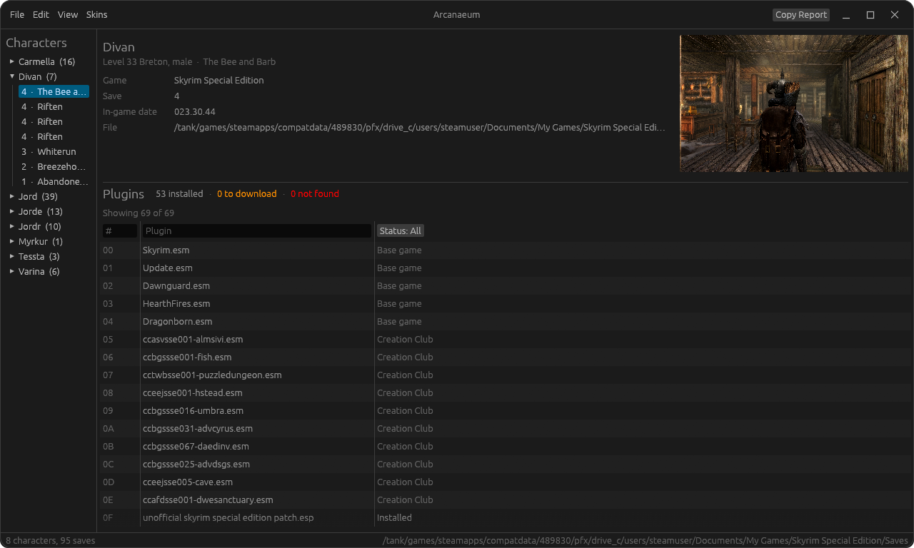

# Arcanaeum


Arcanaeum will analyse your Skyrim save games to determine which mods you used for that save, and manage your load order.


Pick a character and one of their saves, and Arcanaeum lists every plugin the save was made with: base game, Creation Club, active, disabled (in the game's `Data` folder but switched off in `Plugins.txt`), or not installed, with download links from the Vortex masterlist where it has them, beside the screenshot the game took when saving. **Enable Disabled Plugins** switches on everything the save needs that's already installed.

**Load Order** lists every plugin the game knows of, in load order, and switches each one on or off. Changes wait until **Apply** (Ctrl+S), which writes `Plugins.txt` and keeps the old one as `Plugins.txt.bak`; Edit > Revert Changes drops them. Arcanaeum won't apply while Skyrim is running, since the game rewrites `Plugins.txt` when it quits, and asks before quitting with changes not applied.

Each column of a plugin list has a filter in its header: the index, any part of the name, and which statuses to show. **Copy Report** puts the list on the clipboard.

It works with Skyrim Special Edition on Steam, on Linux through Proton and on Windows. It finds the game through the Steam library that owns it; for a copy installed elsewhere, use File > Set Game Folder. The game's files are read and written through [skyplug-core](https://crates.io/crates/skyplug-core), the library behind [skyplug](https://github.com/divanvisagie/skyplug).

It's a [Patina](https://sectorflabs.com/patina/) app: an egui desktop app with its own window frame, the desktop's light/dark setting, and the suite's skins.

### Future Plans

- Automatic download and application of mods
- Automatic fixing of common problems like resolution management for ultrawide monitors



## Shortcuts

| Keys | Action |
| --- | --- |
| Ctrl+S | Apply the switched plugins to `Plugins.txt` |
| Ctrl+O | Open a save folder |
| Ctrl+R, F5 | Reload the load order, the folder and the open save |
| Ctrl+Shift+C | Copy the report of what's shown |
| Ctrl+Q | Quit |

## Skins

Skins come from Patina's built-ins and `~/.config/arcanaeum/skins/`. Arcanaeum's own keys colour a plugin's status, and each falls back to the skin's text, warning, link, error and weak colours:

```toml
[app.arcanaeum]
installed = "#4caf50"  # active
disabled = "#e0a030"
available = "#4a90d9"  # not installed, with a download link
missing = "#d04040"    # not found
included = "#808080"   # base game and Creation Club
```

## Install

On Linux, `make install` installs Arcanaeum, its icon and its launcher for the current user under `~/.local` (no sudo; `PREFIX=…` for elsewhere), and `make uninstall` removes them.

## Build

Run `make` to list the targets:

- `make run`: run the app.
- `make test`: run the tests.
- `make check`: tests and clippy.
- `make screenshot`: regenerate `docs/screenshot-*.png` from Divan's newest save, in a scratch config (`CHARACTER=Name` for another character).
- `make icons`: render the window icon from `packaging/linux/arcanaeum.svg`.
- `make build`: a release binary.

Settings are kept in `~/.config/arcanaeum/config.toml`. Design decisions are in [`docs/adr/`](docs/adr/README.md).

## Licence

BSD 3-Clause, see [LICENSE](LICENSE). Versions before October 2026 were released under MIT.

## Resources

## Info about the file format

https://en.uesp.net/wiki/Skyrim_Mod:Save_File_Format https://en.uesp.net/wiki/Skyrim_Mod:File_Format_Conventions

### Info about matching plugins

https://www.nexusmods.com/news/13921

### List of skyrim mods can be found here

https://github.com/loot/skyrimse

## Origin of the name

https://en.uesp.net/wiki/Skyrim:The_Arcanaeum
