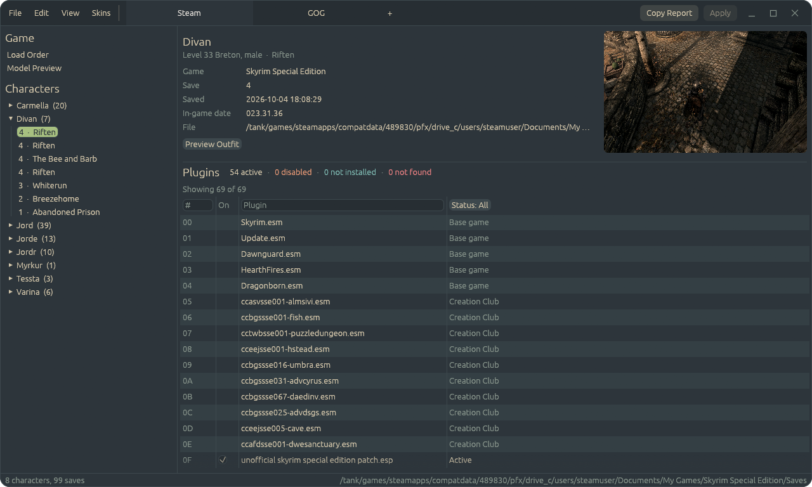
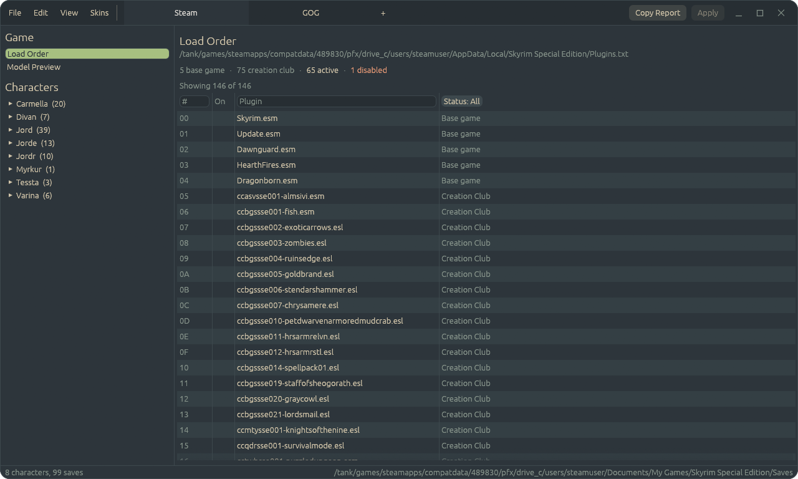
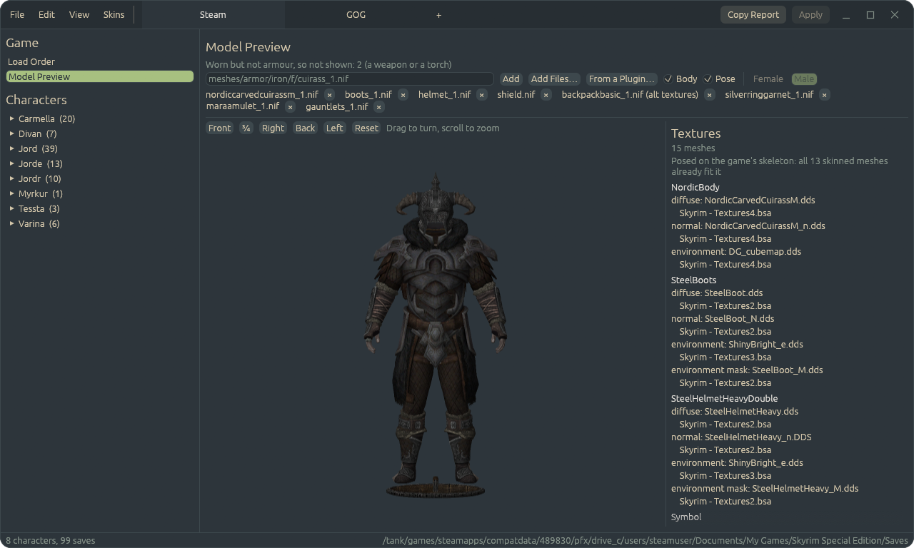
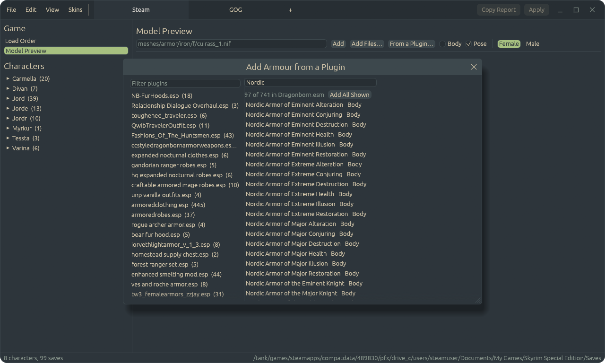

# Arcanaeum


Arcanaeum is a Skyrim mod tool for Linux and Windows. It tells you which mods your saves need, lets you switch plugins on and off, and shows you what your armours and outfits look like, without launching the game.



**Saves.** Pick a character and one of their saves. You'll see every plugin that save was made with, and whether each one is on, switched off or missing, with a download link when it can find one. **Enable Disabled Plugins** turns on everything the save needs that you already have.

**Load Order.** See all your plugins in order and switch them on or off. Nothing changes until you hit **Apply** (Ctrl+S). Your old `Plugins.txt` is kept as `Plugins.txt.bak`, and Edit > Revert Changes undoes everything you haven't applied. It won't apply while Skyrim is running, and it asks before you quit with changes you haven't applied.



**Model Preview.** Look at a model with the textures the game would use, without starting the game. Handy for checking a new mod or a texture you've edited. Next to the picture is a list of every texture and where it came from. It's a quick check, not the game's own renderer.



**Preview Outfit** (on a save's page) shows what that character is wearing, on a male or female body to match. It only draws the outfit, not the character. Picking armours yourself, you can switch between **Female** and **Male** at the top; with an outfit from a save, that's locked to the character.

**From a Plugin…** lets you pick armours from any plugin in your load order.



Every plugin list has filters at the top of its columns, and **Copy Report** copies the list.

It works with Skyrim Special Edition from Steam or GOG, on Linux (Proton or Wine) and Windows. Set up each copy in File > Settings: where the game is and, on Linux, its Wine prefix. **Fill In From Steam** does it for you, and so does the first run.

Each copy of the game gets its own tab at the top; `+` adds one. You can't leave a tab while it has changes you haven't applied.

Under the hood it uses [skyplug-core](https://crates.io/crates/skyplug-core), the library behind [skyplug](https://github.com/divanvisagie/skyplug). It's a [Patina](https://sectorflabs.com/patina/) app, so it follows your light/dark setting and has skins.

### Future Plans

- Automatic download and application of mods
- Automatic fixing of common problems like resolution management for ultrawide monitors

## Shortcuts

| Keys | Action |
| --- | --- |
| Ctrl+S | Apply your changes |
| Ctrl+O | Open a save folder |
| Ctrl+, | Settings for this tab |
| Ctrl+PageUp, Ctrl+PageDown | Previous or next tab |
| Ctrl+Shift+T | Add a tab for another copy of the game |
| Ctrl+R, F5 | Reload everything |
| Ctrl+Shift+C | Copy the report |
| Ctrl+Q | Quit |

## Skins

Skins come from Patina's built-ins and `~/.config/arcanaeum/skins/`. A skin can also set the plugin status colours; any you leave out use the skin's own colours:

```toml
[app.arcanaeum]
installed = "#4caf50"  # active
disabled = "#e0a030"
available = "#4a90d9"  # not installed, with a download link
missing = "#d04040"    # not found
included = "#808080"   # base game and Creation Club
```

## Install

On Linux, `make install` installs Arcanaeum just for you, under `~/.local` (no sudo; use `PREFIX=…` to put it elsewhere). `make uninstall` removes it.

## Build

Run `make` to list the targets:

- `make run`: run the app.
- `make test`: run the tests.
- `make check`: tests and clippy.
- `make screenshot`: retake the screenshots in `docs/` (options are at the top of `scripts/screenshots.sh`).
- `make windows-test`: run the tests as Windows programs under Wine ([how](docs/windows-testing.md)).
- `make icons`: redraw the window icon from `packaging/linux/arcanaeum.svg`.
- `make build`: a release binary.

Settings live in `~/.config/arcanaeum/config.toml`. Design decisions are in [`docs/adr/`](docs/adr/README.md).

## Licence

BSD 3-Clause, see [LICENSE](LICENSE). Versions before October 2026 were released under MIT.

## Resources

## Info about the file format

https://en.uesp.net/wiki/Skyrim_Mod:Save_File_Format https://en.uesp.net/wiki/Skyrim_Mod:File_Format_Conventions

### Info about matching plugins

https://www.nexusmods.com/news/13921

## Origin of the name

https://en.uesp.net/wiki/Skyrim:The_Arcanaeum
