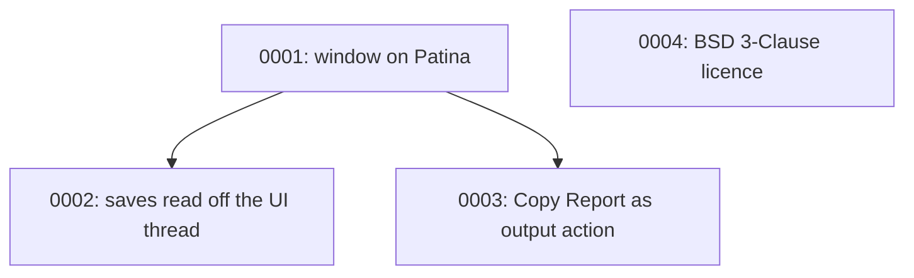

# Architecture Decision Records

This directory holds ADRs for Arcanaeum — short records of significant architecture decisions,
written at the time they're made, following Michael Nygard's format as popularized by Martin
Fowler: <https://martinfowler.com/bliki/ArchitectureDecisionRecord.html>.

## When to write one

Write an ADR when a decision is:

- Hard, or expensive, to reverse once other code depends on it.
- Not obvious from reading the code — a "why", not a "what".
- The kind of thing that'll get re-litigated later without a record ("didn't we already decide
  this?").

Small, reversible choices don't need one. Rule of thumb: if you'd want to explain the choice to a
new contributor in a paragraph beyond what the code itself shows, it's ADR-sized.

An ADR is a point-in-time record of *a decision as it was made*, including the options considered
and rejected. It does not get rewritten later — a decision that reverses or replaces an earlier one
gets its own new ADR that supersedes the old one, which stays in place with its status updated.

## Convention

- One file per decision: `NNNN-short-kebab-title.md`, numbered sequentially, zero-padded to 4
  digits. Numbers are never reused, even for a decision that gets reversed.
- Start from [`0000-template.md`](0000-template.md) — copy it, don't write from scratch.
- `Status` is one of: `Proposed`, `Accepted`, `Rejected`, `Deprecated`, or `Superseded by
  ADR-NNNN` (linked to the superseding record).
- Every new ADR gets a row in the index below.
- Keep records short — a paragraph or two per section is normal. An ADR documents a decision and
  its reasoning, not a design document.

Arcanaeum is a [Patina](https://github.com/Sector-F-Labs/patina) app. Decisions about the shared
frame, skins and components are recorded in Patina's own ADRs; record here only what this app
decides.

If you're working with Claude Code in this repo, `.claude/skills/adr/SKILL.md` automates the
mechanics of adding one.

## Index

| # | Title | Status |
|---|-------|--------|
| [0001](0001-build-on-patina.md) | Rebuild Arcanaeum's window on Patina | Accepted |
| [0002](0002-read-saves-off-the-ui-thread.md) | Read saves on a worker thread | Proposed |
| [0003](0003-copy-report-is-the-output-action.md) | Copy Report is the title bar's output action | Proposed |
| [0004](0004-relicense-as-bsd-3-clause.md) | Relicense from MIT to BSD 3-Clause | Accepted |

## Decision Relationship

## Revisit Triggers

- Opening a save waits noticeably behind a folder scan → [ADR-0002](0002-read-saves-off-the-ui-thread.md).
- Arcanaeum gains an action that fetches or installs mods → [ADR-0003](0003-copy-report-is-the-output-action.md).
